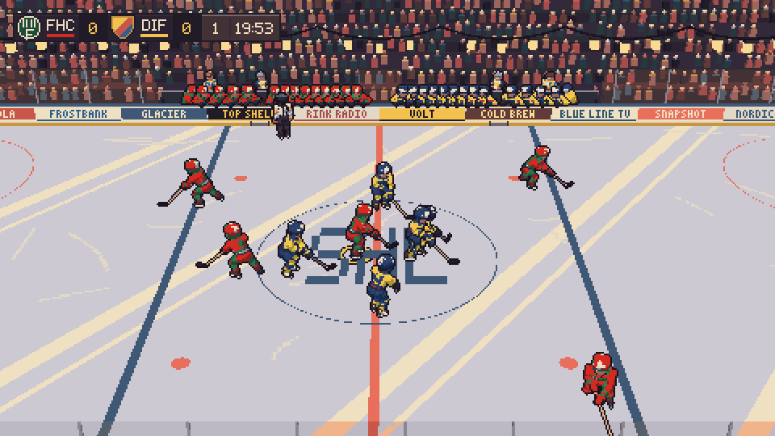
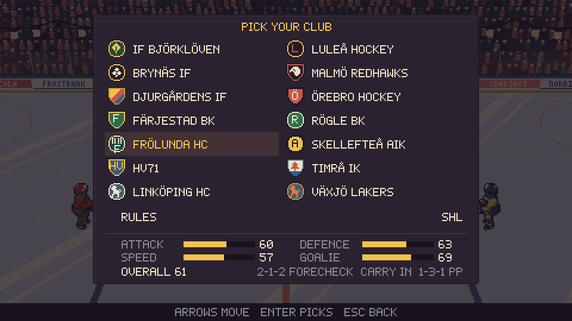
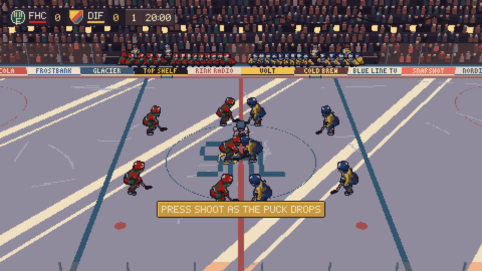

# Stick and puck

A silly attempt at rendering 3D as pixel art in the form of a hockey game. Pick a club, chase the puck, and try to stay out of the box.

## Drop the puck

**[Download the latest release](https://github.com/MattiasHognas/StickAndPuck/releases/latest)** for Linux or Windows. The game includes .NET and its assets—no SDK needed.

- **Windows:** run `StickAndPuck-vX.Y.Z-win-x64.exe`.
- **Linux:** make the downloaded file executable with `chmod +x StickAndPuck-vX.Y.Z-linux-x64`, then run it.
- **Mac** run `StickAndPuck-vX.Y.Z-osx-arm64.exe`.
- **Browser** unpack and serve `StickAndPuck-vX.Y.Z-wasm-browser.zip`.

(Replace `vX.Y.Z` with the version you downloaded.)

Start an exhibition, take one of the 14 clubs through a 52-game season and playoffs, or try arcade mode with one loss or three lives. Seasons autosave after matches. Menus are available in English and Swedish.

## One or two players

- **Single player:** play an exhibition, a season or an arcade run against the computer.
- **Local versus:** two people share one computer, one on the keyboard and one on a gamepad (or two gamepads).
- **Online versus:** two people play over the network, one hosting and one joining by address (desktop only). See [Playing: online versus](docs/PLAYING.md#online-versus).

## Get moving

| Action | Keyboard / mouse | Gamepad |
| --- | --- | --- |
| Skate / sprint | WASD or arrows / Shift | Left stick or d-pad / RT |
| Shoot | Space or left click; hold to load up | A |
| Pass | E or right click | X |
| Check / deke | Q / R | B / RB |
| Switch player / change line | C / L | Y / LB |
| Pause | Esc or P | Start |

Press shoot or pass **after the puck drops** to win a faceoff. Pressing early is a violation: your centre is waved out and a winger takes the draw. Rebind controls, choose difficulty and rules, or adjust sound in settings.

## Behind the boards

- [Playing](docs/PLAYING.md): full controls, settings and saves.
- [Development](docs/DEVELOPMENT.md): build/run commands, environment variables, art and releases.
- [Testing](docs/TESTING.md): automated tests, every visual scene and screen preview, screenshots and replays.
- [Architecture](docs/ARCHITECTURE.md): folders, systems, world state and the pixel pipeline.
